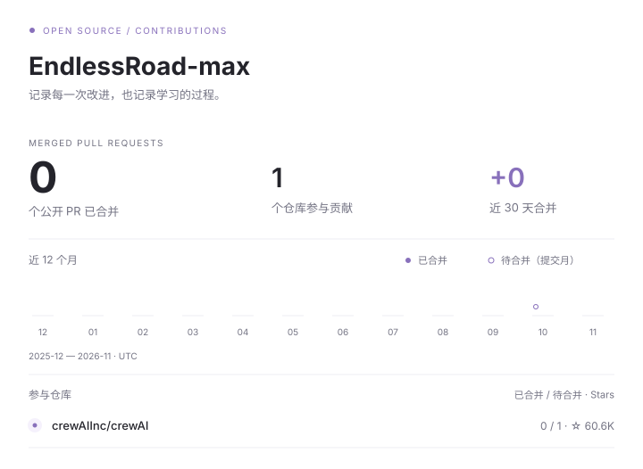

# 你好，我是陈书研

上海理工大学计算机技术专业研二在读，专注全栈开发，正在学习与实践 AI Agent。

我关注从页面交互、服务端逻辑到数据存储的完整开发过程，也喜欢追问技术背后的原理。在个人网站里，我记录学习笔记、问题的验证过程，以及实践中的思考。

[个人网站](https://endlessroad-max.github.io/) · [技术笔记](https://endlessroad-max.github.io/notes/) · [邮件联系](mailto:18852931013@163.com)

## 技术方向

- **后端**：Java、Spring Boot、MyBatis、MySQL
- **前端**：HTML、CSS、JavaScript、Vue
- **缓存与消息**：Redis、RabbitMQ
- **Agent 学习与实践**：Python、模型 API、工具调用、会话管理、MCP

## 最近关注

- 前端交互、组件组织与前后端协作。
- Java 并发、数据库事务、缓存一致性与消息幂等。
- Agent 执行流程、上下文管理与异常处理。

## 公开贡献

<!-- contributions:start -->
<picture>
  <source media="(prefers-color-scheme: dark)" srcset="assets/contributions-dark.svg">
  
</picture>

- [crewAIInc/crewAI #8484](https://github.com/crewAIInc/crewAI/pull/8484) — 待合并
  fix(tasks): clear stale output when conditional tasks are skipped

<!-- contributions:end -->
